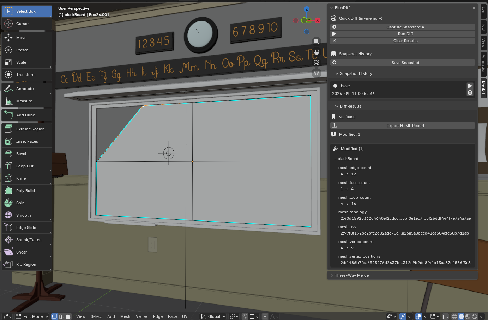
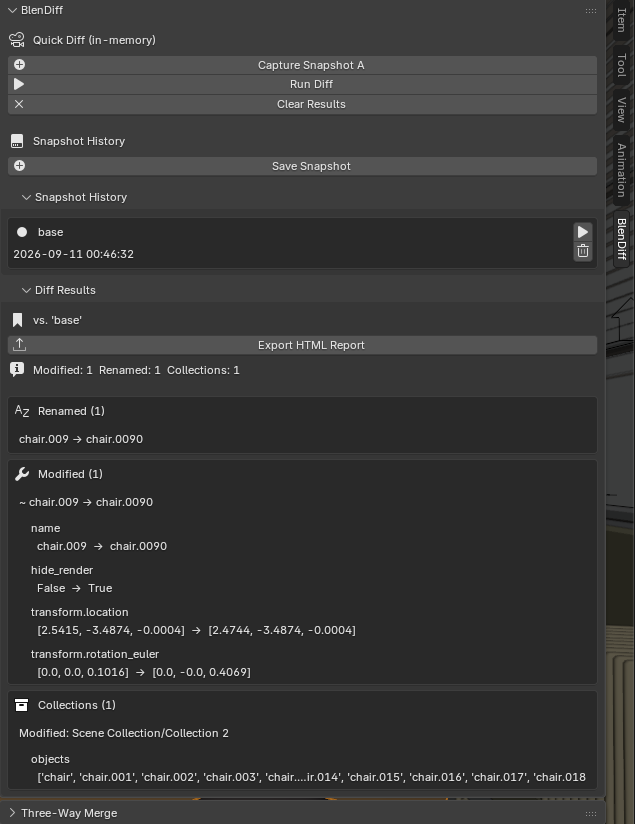
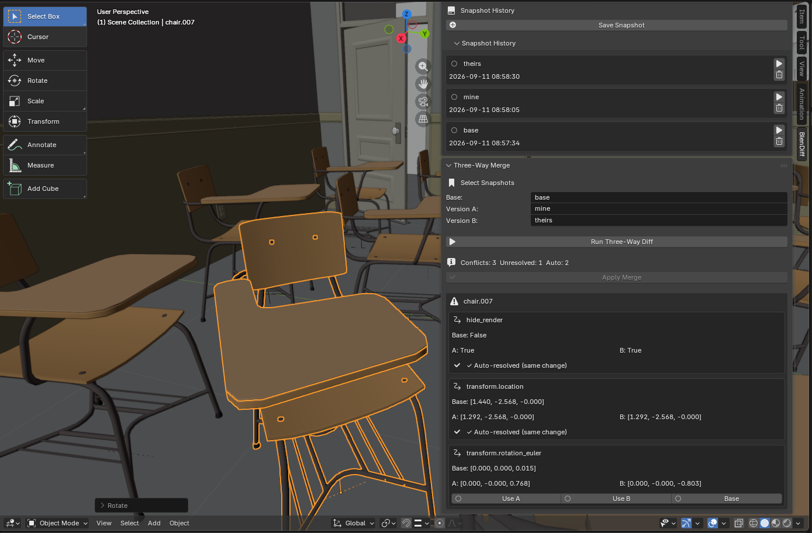

# BlenDiff

**See what changed between two versions of a `.blend` file.**

BlenDiff compares scenes, not bytes. It reads the file through Blender's own
Python API, so instead of "these files differ" you get "this chair moved, that
material was rewired, this mesh was subdivided". Save a snapshot whenever you
reach a point worth keeping, then compare any two of them, or compare one
against whatever is open now.

Snapshots live in a `.blendiff` file next to your `.blend`, so a project folder
holds those two files and nothing else.

---

## Detecting a geometry edit

The blackboard was reshaped in edit mode. BlenDiff picks up the new topology,
the changed vertex positions and the UVs, without storing a copy of the mesh.



## Comparing against a snapshot

Object level changes, property by property. The chair here was renamed, hidden
from renders, moved and rotated, and BlenDiff tracks the rename as a rename
rather than reporting an unrelated deletion and addition.



## Merging two versions

Give BlenDiff a common starting point and two versions that grew apart. It
applies the changes that do not overlap and asks you about the ones that do.
Apply Merge stays disabled until nothing is left undecided.



---

## What it compares

- **Objects**: position, rotation, scale, parenting and custom properties
- **Visibility**: viewport and render switches, selectability, display mode,
  and the per-ray flags that decide whether something casts a shadow or shows
  up in reflections
- **Meshes**: a moved vertex, a subdivided face or a re-unwrap, caught by comparing
  content digests rather than storing the geometry
- **Materials**: node graphs, node by node, including rewired links and image names
- **Armatures**: bone hierarchy, rest pose, roll, bone collections, pose transforms
  and bone constraints, so a reparented finger or a rewired IK chain is visible
- **Modifiers and constraints**: the whole stack, in order, with per setting detail
- **Geometry nodes**: the node group on a modifier and every input it exposes,
  by the name you see in the panel rather than an internal socket number
- **Shape keys**: each key's value, mute, slider range and interpolation, plus
  whether the shape itself was sculpted
- **Animation**: keyframe counts, frame ranges, interpolation, drivers and NLA tracks
- **Scene settings**: render engine, resolution, sampling, output format, colour
  management, world background, cameras and lights
- **Collections**: which objects belong where, and whether a collection is
  hidden, excluded or set to holdout
- **Curves, text, empties and the rest**: the settings that shape them, such
  as a curve's bevel and extrude or a text object's contents and spacing

Renames are tracked properly. Objects carry a hidden id, so renaming `Cube` to
`Body_LOW` stays one modified object with its other changes intact.

Snapshots also record which of these they captured. If an old snapshot predates
a feature, that part is reported as **not compared** instead of being diffed, so
upgrading BlenDiff never fills your first diff with changes nobody made.

---

## Installation

**Blender 4.2 and newer**

Edit > Preferences > **Get Extensions**, search for **BlenDiff**, click Install.
Updates arrive on their own.

**Blender 3.6 to 4.1**

Download the latest `blendiff-<version>.zip` from
[Releases](https://github.com/Vishrut2403/blendiff/releases) and install it with
Edit > Preferences > Add-ons > **Install from Disk**.

Either way, the panel appears in the 3D viewport sidebar. Press **N** and look
for the **BlenDiff** tab.

---

## Using it

1. Save your `.blend` file. BlenDiff needs somewhere to put its history.
2. Press **Save Snapshot** and give it a name, something like "before rigging".
   If you would rather not remember, turn on **Snapshot on save** in the
   add-on preferences and one is taken every time you save. Those are pruned
   to a limit you set; the ones you take by hand are kept.
3. Carry on working.
4. Open **Snapshot History** and press play next to any snapshot to compare it
   against the current scene. To compare two saved snapshots to each other
   instead, pick them in **Compare Two Snapshots** and press Compare.
5. Tick **Store geometry** when saving a snapshot and its vertex positions
   are kept too, so restoring it returns meshes to the shape they had. Much
   larger on disk, so it is off unless you ask for it, and it cannot undo a
   change to the topology such as a re-mesh or a subdivide.
6. To go back, press the restore button beside a snapshot. It writes that
   snapshot's values over the scene in one undo step, and tells you what it
   could not account for. It never creates or deletes objects, so anything
   made since the snapshot is left alone.
7. **Export HTML Report** writes a single self contained page you can send to
   someone who does not have the file open.

For a merge, take a snapshot of the common starting point, then one of each
version that grew from it, and pick all three in the **Three-Way Merge** panel.

---

## What merge writes back

BlenDiff only claims to apply what it can actually apply. Anything it cannot
write back is shown as read only, so it never asks you to choose a value it
would then discard.

| Applied for you | Reported, but reconcile by hand |
|---|---|
| Position, rotation, scale | Mesh topology, such as a re-mesh |
| Mesh shape, from a snapshot that stored geometry | A sculpted shape key |
| Viewport and render visibility | Keyframes, drivers and NLA strips |
| Object names | Material node graphs |
| Collection membership | Mesh shape, without stored geometry |
| Parenting, keeping world position | Collection visibility |
| Pose bone transforms | Adding or removing an object |
| Rest bones: parenting, rest pose, roll | Adding or removing a bone |
| Constraint settings, on objects and bones | Adding, removing or retyping a constraint |
| Modifier settings and stack order | Adding, removing or retyping a modifier |
| Geometry nodes inputs | Swapping a node group |
| Shape key value, mute and slider range | Adding or removing a shape key |
| Curve, text, empty and lattice settings | Settings that link to another datablock |
| Camera and light settings | |
| Material slot assignment | |
| Custom properties | |

---

## What it cannot do

BlenDiff is honest about its limits rather than letting you find them during
a merge. The things it will not do, and why:

- **It never creates or deletes objects.** An object in a snapshot but not in
  your scene was deleted since, and nothing in a snapshot can rebuild it. One
  in your scene but not in the snapshot was made since, and removing it while
  claiming to restore is not something a tool should do quietly. Both are
  reported.
- **It cannot undo a change to mesh topology.** A snapshot that stored
  geometry puts vertices back where they were, which covers sculpting and
  moving things. A re-mesh, a subdivide or anything that changes the vertex
  count leaves those positions describing geometry that no longer exists, so
  the restore is refused rather than applied.
- **Keyframes, drivers and NLA strips are summarised, not stored.** A diff
  tells you a channel changed; it cannot rebuild the curve.
- **Material node graphs are compared but not written back.** Rewiring a
  shader is reported node by node and reconciled by hand.
- **Adding, removing or retyping a modifier or constraint is reported only.**
  A snapshot records an added one by name and type with no settings, so
  creating it would quietly give it defaults and call that a success.

Everything it does apply is in the table above, and anything it cannot is
shown read only in the merge panel with the reason, so you are never asked to
choose a value it would then discard.

---

## The .blendiff file

Your history lives in a single JSON file beside the `.blend`. It is plain
text, so you can read it, and version it alongside the `.blend` if you want.

From 1.0 onwards the format carries a promise: **any 1.x BlenDiff reads any
sidecar written by any other 1.x, and every older format keeps opening.**
Files written by the 0.1, 0.2 and 0.3 formats are still read today and are
upgraded in place the next time they are written. A file from a newer
BlenDiff than yours is read anyway, with a warning, because locking you out
of your own history over a version string would be the worse failure.

## Also available as a Python library

BlenDiff installs from PyPI as a plain Python package, with no Blender required,
for comparing snapshots in scripts or in continuous integration:

```bash
pip install blendiff
```

See [docs/development.md](docs/development.md) for the command line tool and the
Python API, and [docs/architecture.md](docs/architecture.md) for how the code is
put together.

---

## License

GPL-3.0-or-later. See `LICENSE`.

BlenDiff is licensed under the GNU General Public License v3 or later because
Blender's Extensions Platform requires it: anything using the `bpy` API is
treated as a derivative of Blender, which is itself GPL. The pip package and
the Blender addon ship the same code under the same terms.
